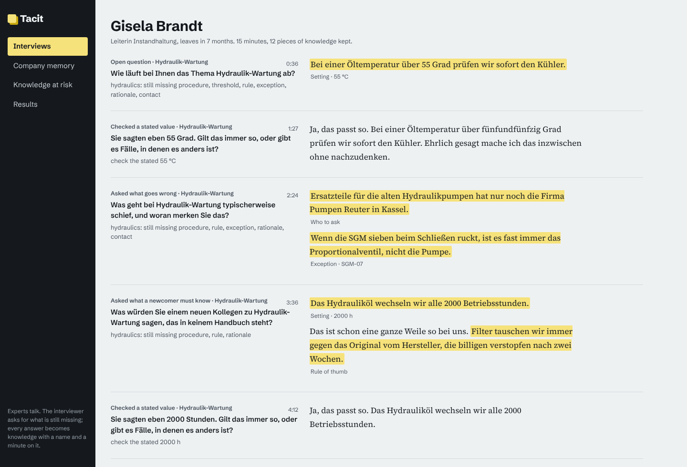
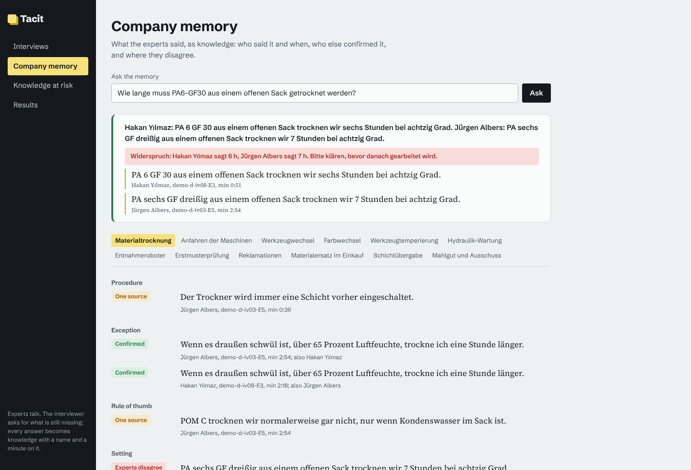
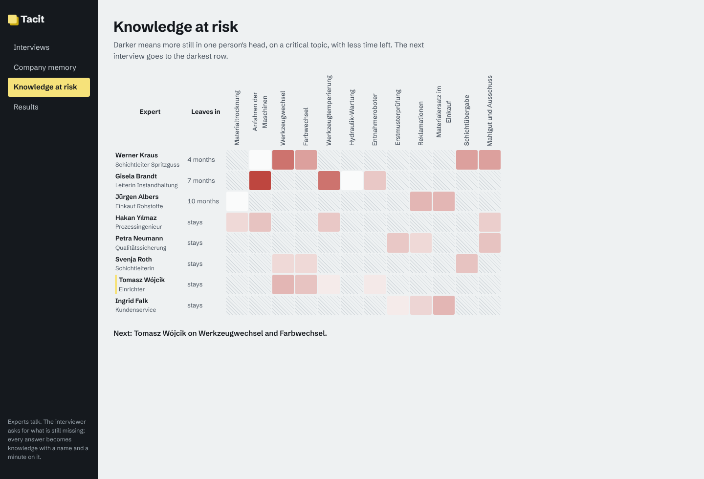

<!-- generated by npm run readme -->
# tacit-knowledge-interviewer

[](https://github.com/manojrevenkar12-web/tacit-knowledge-interviewer/actions/workflows/ci.yml)

An AI voice interviewer that captures what experienced staff know before they retire, and a company memory that
answers new colleagues from it. The interviewer is a **LangGraph** workflow that decides each next question in code:
it stays on a topic while some kind of knowledge is still missing (the exceptions, the numbers, the people to call),
checks every number an expert states, and moves on when two answers in a row add nothing. A **LiveKit** voice agent
(Python) speaks the questions and listens in German; every answer becomes claims with a quote, the expert's name and
the minute. Code keeps only quotes that are in the transcript, turns spoken identifiers ("SGM sieben", "PA sechs GF
dreißig") into master-data IDs, and builds a **knowledge graph** that marks what two experts confirmed, what only one
said, and where they disagree. New staff ask in plain German; the answer cites who said it, warns about conflicts,
and says "not captured yet" rather than guess. A planner weighs knowledge at risk (who leaves soonest, on critical
topics, minus what is captured) and suggests the next session.

**Stack:** TypeScript (Node 22), LangGraph JS with interrupts and checkpoints, the OpenAI SDK against any
OpenAI-compatible endpoint (OpenAI or Azure OpenAI), zod, Fastify, PostgreSQL with **pgvector**, **Next.js** console,
**LiveKit Agents** in Python with OpenAI or Azure OpenAI speech. The company, its experts and its knowledge are
simulated and invented, with their own truth, so every design can be scored.

## Results

Dev seeds dev-1, dev-2, dev-3, dev-4, dev-5: one invented injection-moulding company per seed, 62 pieces of knowledge spread
over 8 experts (three of them retiring within a year), a budget of 3 expert hours and at most
16 sessions, then 45 questions from new staff (5 about things nobody knows).
Every design meets the same experts, who give the same answers to the same questions.

| Design | Knowledge captured <sub>(per seed)</sub> | Tacit knowledge | Critical knowledge of leaving experts | Captured per expert hour | Expert time per company | Wrong values kept as fact | Staff questions answered right | Wrong answers | Honest "not captured yet" | Model and voice cost per session |
|---|--:|--:|--:|--:|--:|--:|--:|--:|--:|--:|
| Fixed questionnaire, transcript search | 71% <sub>61%–76%</sub> | 58% | 57% | 21.5 | 2.0 h | 12 | 64% | 23.1% | 11% | 7.2 ct |
| A model interviews freely, transcript search | 75% <sub>60%–84%</sub> | 70% | 71% | 13.6 | 3.4 h | 12 | 68% | 22.7% | 8% | 37.3 ct |
| **Gap-driven interviews, risk planner, cited graph** | **90%** <sub>84%–95%</sub> | **87%** | **97%** | **23.5** | **2.4** h | **2** | **76%** | **1.8%** | **19%** | **8.3 ct** |
| Platform without checking stated numbers | 87% <sub>74%–92%</sub> | 88% | 94% | 24.8 | 2.2 h | 11 | 73% | 4.4% | 19% | 7.6 ct |
| Platform, sessions in alphabetical order | 85% <sub>81%–94%</sub> | 84% | 92% | 23.5 | 2.3 h | 7 | 74% | 4.4% | 20% | 7.9 ct |
| Platform interviews, answers from transcripts | 90% <sub>84%–95%</sub> | 87% | 97% | 23.5 | 2.4 h | 2 | 79% | 16.4% | 3% | 8.3 ct |

- **The gap-driven interviewer captures 90% of what the experts know, 87% of the tacit part**,
  against 71% and 58% for a fixed questionnaire and 75% and 70% for a model interviewing freely,
  which also needs 3.4 hours of expert time instead of 2.4.
- **97% of the critical knowledge only the leaving experts hold is captured** (questionnaire 57%).
- **Checking stated numbers matters:** without the check, 11 pieces of knowledge sit in the memory with a wrong value
  and no warning; with it 2. Experts misremember; asked "Gilt das immer?", most correct themselves.
- **Answers from the graph are wrong 1.8% of the time; from the same interviews' transcripts 16.4%.**
  Transcript search answers more questions (79% right) because it rarely says "I don't know"; the graph says
  "not captured yet" on 19% of questions, which includes the 11% nobody can answer.
- **Scheduling by risk helps a little:** the same interviews in alphabetical order capture 85%, 92% of the leaving experts' critical knowledge.

### Held-out seeds

Not run yet: `npm run lock`, then `npm run heldout`, once.

### What the platform captures, by kind (dev)

| Kind of knowledge | In the experts' heads | Captured |
|---|--:|--:|
| Settings and numbers | 80 | 95% |
| Exceptions and failure cases | 75 | 87% |
| Rules of thumb | 55 | 89% |
| Reasons | 45 | 84% |
| Procedures | 30 | 100% |
| Who to ask | 25 | 84% |

| Leaving expert | Leaves in | Critical knowledge only they hold | Captured |
|---|--:|--:|--:|
| Werner Kraus | 4 months | 18 | 100% |
| Gisela Brandt | 7 months | 29 | 100% |
| Jürgen Albers | 10 months | 14 | 86% |

### What an interview sounds like

The opening turns of the first dev session, as speech-to-text wrote the answers:

> **open question** (startup: still missing procedure, threshold, rule, exception, rationale, contact)<br>
> *Wie läuft bei Ihnen das Thema Anfahren der Maschinen ab?*<br>
> Erst die Werkzeugtemperierung an, dann die Zylinderheizung, dann die Hydraulik. Da müsste ich eigentlich mal nachschauen.<br>
> → kept: procedure
>
> **asks what goes wrong** (startup: still missing threshold, rule, exception, rationale, contact)<br>
> *Was geht bei Anfahren der Maschinen typischerweise schief, und woran merken Sie das?*<br>
> Der Zylinder der SGM 3 braucht beim Anfahren 30 Minuten zum Aufheizen. Beim Anfahren der SGM-07 fahren wir erst 5 Schuss in den Ausschuss. Die SGM 7 macht nach dem Wochenende Ärger mit der Düse, die muss man zehn Minuten länger vorheizen.<br>
> → kept: threshold 30 min on SGM-03; threshold 5 Schuss on SGM-07; exception on SGM-07
>
> **checks a stated value** (check the stated 30 min)<br>
> *Sie sagten eben 30 Minuten bei SGM-03. Gilt das immer so, oder gibt es Fälle, in denen es anders ist?*<br>
> Ja, das passt so. Der Zylinder der SGM drei braucht beim Anfahren 30 Minuten zum Aufheizen.<br>
> → nothing kept
>
> **checks a stated value** (check the stated 5 Schuss)<br>
> *Sie sagten eben 5 Schuss bei SGM-07. Gilt das immer so, oder gibt es Fälle, in denen es anders ist?*<br>
> Ja, das passt so. Beim Anfahren der SGM sieben fahren wir erst 5 Schuss in den Ausschuss.<br>
> → nothing kept
>
> **asks what a newcomer must know** (startup: still missing rule, rationale, contact)<br>
> *Was würden Sie einem neuen Kollegen zu Anfahren der Maschinen sagen, das in keinem Handbuch steht?*<br>
> Das ist schon eine ganze Weile so bei uns. Das läuft eigentlich ganz normal.<br>
> → nothing kept

### Release gate

`npm run gate` **passes**: knowledge captured 0.9 (≥ 0.85); knowledge at risk captured 0.9683 (≥ 0.85); staff questions answered right 0.76 (≥ 0.7); wrong answers 0.0178 (≤ 0.06); wrong values stated as fact 2 (≤ 10); cost per session (ct) 8.33 (≤ 15); capturedShare beats questionnaire 0.9 (> 0.7097); atRiskShare beats questionnaire 0.9683 (> 0.5714); capturedShare beats free_llm 0.9 (> 0.7516); perExpertHour beats free_llm 23.49 (> 13.62).

## The console







## How it works

1. **Plan the session.** For every expert and topic: a prior of what is still in their head, less what the graph
   holds from them, weighted by how soon they leave and whether the topic is critical. The highest goes first.
2. **Ask.** A LangGraph `StateGraph` per interview: choose the next move in code (open, example, what goes wrong,
   settings, why, newcomer, who to call, check a value), have the model word it in German, pause at `interrupt()`
   until the expert has answered by voice or text, read the answer, choose again. Checkpointed per interview.
3. **Read.** The model returns claims with quotes; code drops any quote not in the transcript, drops small talk,
   reads identifiers and values from the quote itself (a model that writes 60 for "sechs Stunden" is overruled).
4. **Link.** Claims with the same subject (topic, identifiers, unit, condition) and the same value corroborate; with
   different values they conflict; an expert's answer to a check replaces what the same expert said before.
5. **Answer.** Hybrid search (BM25 and embeddings, fused by rank; pgvector in the service). No fitting claim: no model
   call, "not captured yet". Otherwise the model answers from the claims it was given; code rejects citations it did
   not offer, claims about something else, and numbers no cited claim has, and writes the conflict and single-source
   warnings itself.
6. **Speak.** `voice/`: a LiveKit Agents worker whose language-model step is the interview brain: the expert's words
   go to `POST /api/interviews/:id/answer`, the next question comes back and is spoken. Azure OpenAI or OpenAI for
   speech.

## Limits

- The company, experts, knowledge, speech-to-text errors and model mistakes are simulated. The numbers compare designs
  on one invented company; they are not a forecast for a real one.
- The simulated experts reveal knowledge by rules (which kind of question brings out which kind of knowledge, fatigue
  after twenty minutes). Real people are less regular; the interviewer's yield table in `config/product.json` is a
  prior to be re-fitted on real interviews.
- An expert who repeats a wrong number when asked to check it stays wrong in the memory; only a second expert can catch
  it, as a conflict.
- Search uses a deterministic hashing embedder so that runs are reproducible; a real embedding model drops in behind
  the same function. German compounds and cross-lingual questions are where it misses most.
- The voice worker is tested in text mode with LiveKit's own session runner; a real room needs a LiveKit server and
  speech keys.

## Run it

```bash
npm ci
npm test                       # pipeline, interview policy, answers, service on PGlite, invariants
npm run typecheck
npm run evaluate && npm run gate && npm run seed && npm run readme

npm run serve                  # memory service on :8795, PGlite in memory (DATABASE_URL for PostgreSQL)
(cd web && npm ci && npm run build && MEMORY_URL=http://localhost:8795 npm start)   # console on :3000

# live interviews with the simulated company standing in for models and experts
OPENAI_BASE_URL=http://localhost:8796/v1 npm run serve &
SESSIONS=3 npm run world -- --interview http://localhost:8795

# voice
cd voice && pip install -e '.[test]' && pytest
python -m interviewer.worker dev   # LIVEKIT_URL, LIVEKIT_API_KEY, LIVEKIT_API_SECRET, MEMORY_URL, OPENAI_API_KEY or AZURE_OPENAI_*

# everything on one machine: PostgreSQL with pgvector, the memory service, the console
docker compose up --build          # OPENAI_BASE_URL and OPENAI_API_KEY for live interviews, LIVEKIT_* for voice
```

## Layout

| Path | What it is |
|---|---|
| `src/product` | interviewer (LangGraph), pipeline (claims, identifiers, graph, search), agents (answers, planner), service |
| `src/world` | the simulated company: knowledge, experts, speech-to-text, models |
| `src/eval` | runs the designs, scores them, writes reports, the demo seed and this README |
| `voice/` | LiveKit Agents worker in Python and its tests |
| `web/` | Next.js console: interviews, company memory, knowledge at risk, results |
| `knowledge/` | what the customer gives at onboarding: org chart, topics, master data |
| `config/` | every setting: models, routes, prices, the interview policy, designs, the world, the gate |
| `docs/adr` | the decisions and why |
| `AGENTS.md`, `SKILLS.md` | the invariants, the held-out rule and the repeatable tasks |
